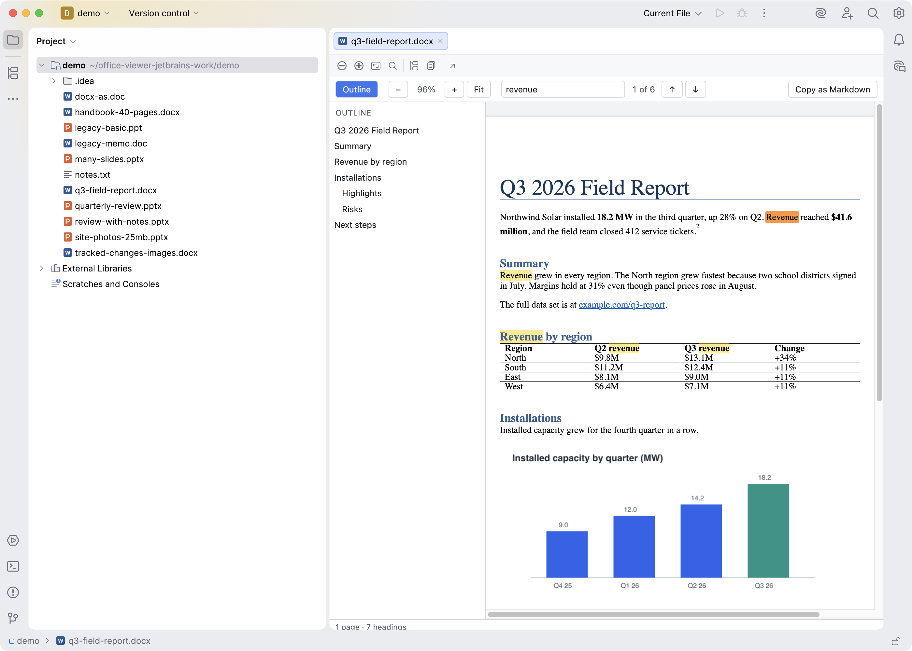
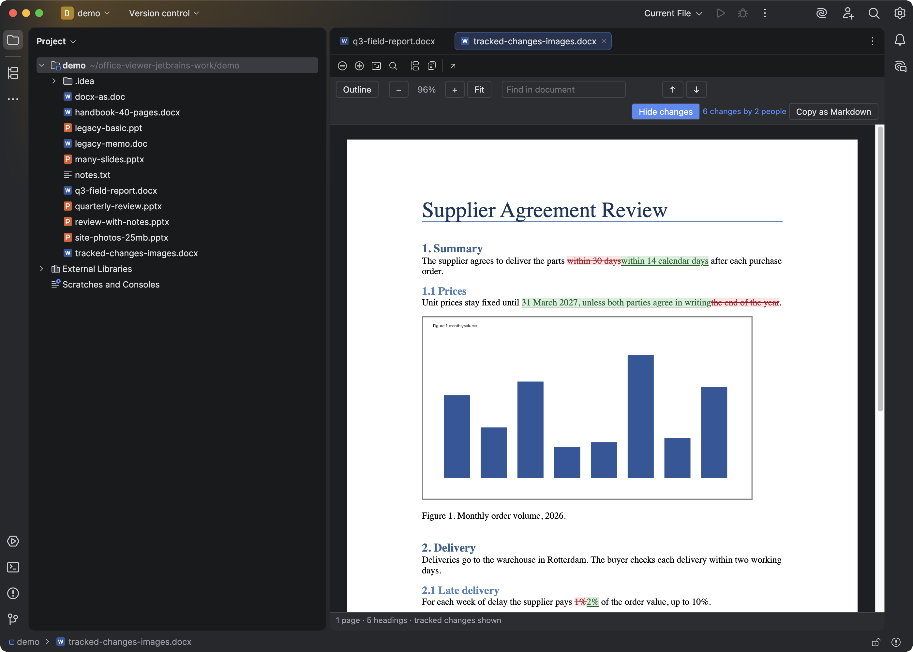
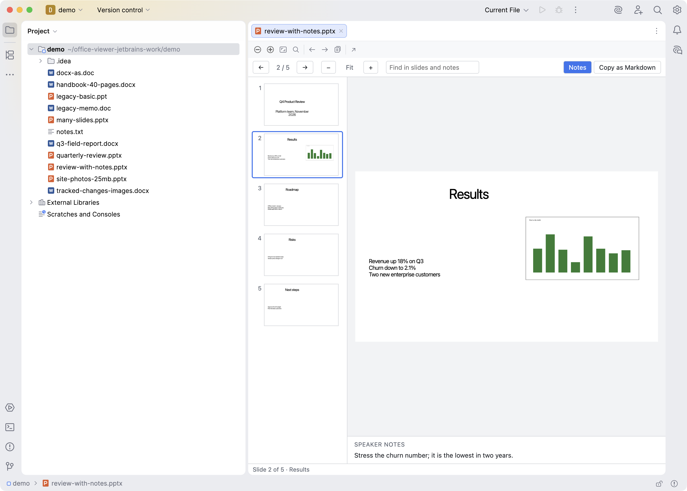

# DOCX & PPTX Viewer for JetBrains IDEs

Open Word and PowerPoint files in an editor tab of IntelliJ IDEA, PyCharm, WebStorm, GoLand, Rider and the other IntelliJ-based IDEs (2025.2 and newer). A .docx shows as pages with their real layout. A .pptx shows as slides with the speaker notes. The viewer is read-only and works offline.

Marketplace: plugin id `zovo.office-viewer`, vendor Zovo.







## Features

Word (.docx, .dotx, .docm):

- Page layout with headers, footers, footnotes, tables and images
- Zoom, and Fit to the window width
- Find with Ctrl+F or Cmd+F, then Enter and Shift+Enter
- A tracked changes button, with a count of the changes and the people who made them
- An outline of the headings
- Copy as Markdown

PowerPoint (.pptx, .ppsx, .pptm, .potx):

- A thumbnail strip next to the large slide
- Arrow keys, Page Up, Page Down, Home and End
- Speaker notes under the slide
- Find in slide text and notes, and Copy as Markdown

Old .doc and .ppt files get a short message on how to convert them and an Open in Default App button. A .docx or .pptx renamed to .doc or .ppt opens normally.

The editor toolbar has Zoom Out, Zoom In, Fit, Find, Outline (Word) or the slide arrows (PowerPoint), Copy as Markdown and Open in Default App.

Limits in 0.1.1: charts in slides show as a box ("Chart not drawn in this version"). SmartArt, video and embedded objects are named in the status line. Comments in Word files are not shown. Word pages break only where the file has a page or section break, so a long document can show fewer, longer pages than Word. Password-protected files cannot be opened; the tab says so. Find marks the first 5,000 matches.

## Privacy

The plugin reads the file you open and nothing else. It makes no network calls. Links inside a document open in your web browser only when you click them.

## Build

```
cd web && npm ci && npm run bundle && npm test   # builds src/main/resources/web/{docx,pptx}.js
cd .. && ./gradlew test verifyPlugin buildPlugin  # JDK 21 toolchain, IntelliJ Platform 2025.2.6.4
./gradlew runIde -PdemoProject=/path/to/folder/with/office/files -PjcefDebugPort=9334
```

The viewer bundles are built with esbuild in `web/` and committed to `src/main/resources/web/`. So the Gradle build does not need Node, and the Marketplace build is the same bytes that were tested. `processResources` fails if a bundle is missing. Run `npm run bundle` after any change under `web/`; it also rewrites THIRD-PARTY-NOTICES.md and stops if a bundled package has a license outside the allow list.

Where the code comes from:

- `web/src/core/` (XML and ZIP readers, the slide parser, the tracked changes summary, Markdown helpers) is the TypeScript port from the Zovo Office Viewer for Obsidian. That was ported from the Zovo DOCX and PPTX viewers for VS Code.
- `web/src/vendor/html.js` is the HTML parser and Markdown writer from the DOCX viewer for VS Code. Its tests run here unchanged (`web/test/html.test.js`).
- Rendering uses docx-preview (Apache-2.0), mammoth (BSD-2-Clause) for Copy as Markdown, and pptx-preview (ISC). See THIRD-PARTY-NOTICES.md for the full list.

## How to reuse the JCEF shell

The package `zovo.jcefshell` has no Office code in it. Copy these files into another plugin to show any file type with a web page:

| File | What it does |
|---|---|
| `src/main/java/zovo/jcefshell/JcefViewerProvider.java` | Abstract `FileEditorProvider` (`DumbAware`, `HIDE_DEFAULT_EDITOR`). It accepts by extension without a read action. When `JBCefApp.isSupported()` is false, it shows a "This viewer needs JCEF" tab with the file size and an Open in Default App button. |
| `src/main/java/zovo/jcefshell/JcefViewerEditor.java` | The `FileEditor`. It holds a `JBCefBrowser` and a `JBCefJSQuery`, a toolbar (zoom, fit, find, your actions, open in default app), and theme updates through `LafManagerListener`. The browser and query are disposed with the editor. |
| `src/main/kotlin/zovo/jcefshell/ViewerRoutes.kt` | Pure routing for the private origin `http://zovo-viewer/`: `/file` gives the open file's bytes, `/<name>.<ext>` gives a resource from your resource folder, and everything else is a 404. Unit tested. |
| `src/main/kotlin/zovo/jcefshell/BytesResourceHandler.kt`, `ViewerRequestHandler.kt` | The CEF side. They serve the routes for one browser only, block all other requests, and send clicked web links to the system browser. |
| `src/main/java/zovo/jcefshell/MessageEditor.java`, `DefaultApp.java` | A plain Swing message tab, and "open with the system app". |

Steps for a new viewer (for example a science file viewer):

1. Put `yourpage.html`, its bundle and CSS in `src/main/resources/<folder>/`. Use relative script URLs, so they load from `http://zovo-viewer/`. ES modules and WASM work there, because it is an http origin and not `file://`.
2. In the page, get the bytes with `fetch("/file")`. Do not pass base64 through `executeJavaScript`, because files can be 50 MB or more.
3. Talk to the IDE with `window.zovoHost.send(JSON.stringify({type: ...}))`. The IDE injects it when the page loads, so queue messages until it exists (see `web/src/host.ts`). Handle `window.zovoCommand(name)` for the toolbar buttons and `window.zovoTheme("dark" | "light")` for theme changes. The page URL also carries `?theme=&name=&ext=`.
4. Subclass `JcefViewerProvider`: implement `acceptsExtension` and `createViewer`, and return `new JcefViewerEditor(file, new JcefViewerEditor.Spec(folder, "yourpage.html", "Tab name", editor -> extraActions, (editor, msg) -> {...}))`.
5. Register it in plugin.xml with `<fileEditorProvider implementation="..."/>`. If the IDE does not know the extension, add a binary `<fileType>`.
6. Copy `ViewerRoutesTest.kt` and `ProviderPlatformTest.kt`, and point them at your resources.

To check the page in a running sandbox, run `./gradlew runIde -PjcefDebugPort=9334` and open `http://127.0.0.1:9334/json/list`.

[zovo-support-start]: #

## Support Zovo

Zovo builds and maintains this plugin. If it saves you time, you can support the work on [GitHub Sponsors](https://github.com/sponsors/theluckystrike). Sponsorship is optional, and the tool works the same without it.

Bug reports and ideas go to [GitHub issues](https://github.com/theluckystrike/office-viewer-jetbrains/issues). The same links are in the IDE under Help, DOCX & PPTX Viewer: Support and More Tools.

Zovo is made by [theluckystrike](https://github.com/theluckystrike) on GitHub.

## More tools by Zovo

- [DOCX Viewer, Word Viewer & DOCX Preview (Dark Mode)](https://marketplace.visualstudio.com/items?itemName=zovo.docx-viewer-vscode) for VS Code. Previews Word and ODT files with dark mode, an outline and search.
- [PPTX Viewer & PowerPoint Viewer, PPT Slide Viewer](https://marketplace.visualstudio.com/items?itemName=zovo.pptx-slide-viewer) for VS Code. Shows PowerPoint slides, thumbnails and speaker notes.
- [PDF Viewer & PDF Reader](https://marketplace.visualstudio.com/items?itemName=zovo.pdf-viewer-dark) for VS Code. Reads PDFs with a real dark mode, search, an outline and thumbnails.
- [Office Viewer for Obsidian](https://github.com/theluckystrike/obsidian-office-viewer). Opens DOCX, PPTX and XLSX files in your Obsidian vault, read-only.
- [All Zovo tools on GitHub](https://github.com/theluckystrike?tab=repositories). Free tools for VS Code, JetBrains IDEs, Obsidian, Apify and Atlassian.

[zovo-support-end]: #

## License

MIT. Not affiliated with Microsoft.
